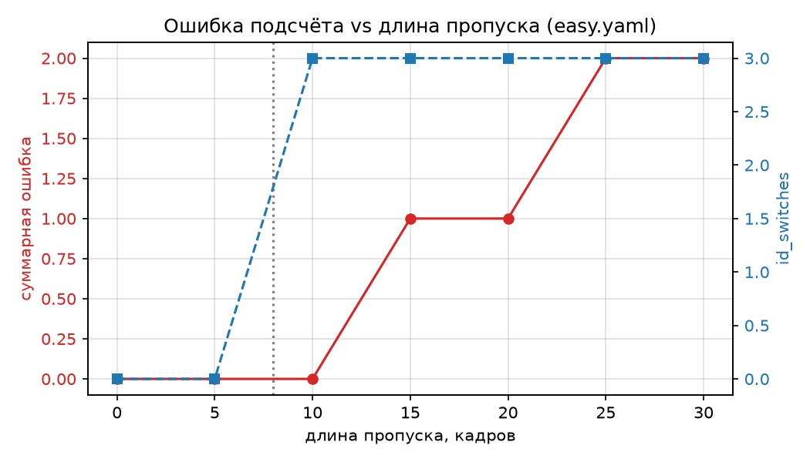
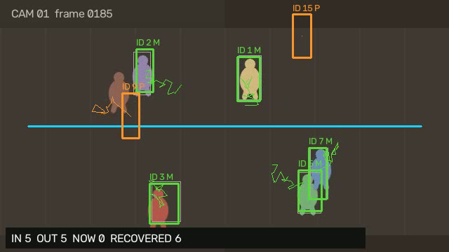
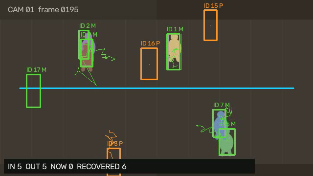
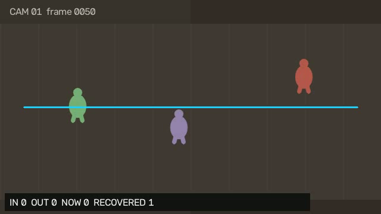
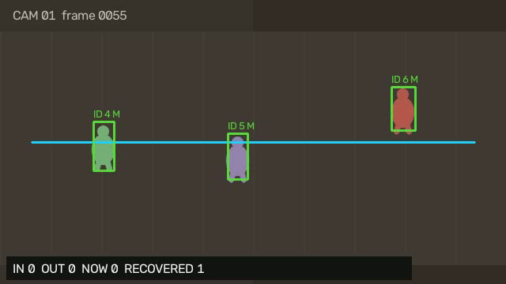
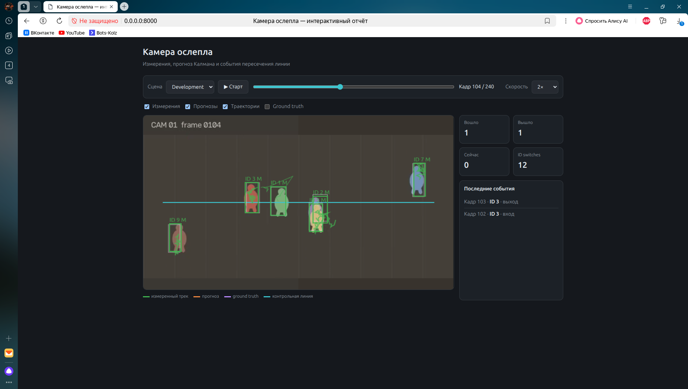

# Домашнее задание №1. Камера ослепла

## Краткое описание.

Представьте, что камера у входа в магазин помогает считать посетителей. Однако обнаружения людей ненадёжны: координаты меняются с небольшой погрешностью, а иногда человек на несколько кадров пропадает из результатов детектора. Если после каждого пропуска считать его новым посетителем, статистика будет неверной.
В этой работе вы разработаете программу, которая сопровождает людей, сохраняет их идентификаторы при коротких пропусках и считает пересечения контрольной линии.

## Суть задачи.

Вам предоставляются три коротких синтетических видео. На них цветные фигуры изображают людей, которые движутся, пересекают траектории и проходят через условный вход. Рядом с каждым видео находится таблица координат — имитация результатов детектора. В неё добавлены шум, пропуски и ложные обнаружения.

Необходимо связать отдельные обнаружения в траектории, продолжать сопровождение при кратковременном отсутствии измерений и определять входы и выходы по пересечению контрольной линии.

## Установка и запуск. 

1. Клонируйте репозиторий.
2. Установите виртуальное окружение (`venv`):
```
python3 -m venv venv
```

3. Установите необходимые зависимости:
```
pip install -r starter_kit/requirements.txt
```

4. Перейдите в директорию с кодом:
```
cd starter_kit
```

5. Запуск сцен:
```
python3 -m src.main     --data ../data/debug       --output results/debug       --config configs/easy.yaml
python3 -m src.evaluate --data ../data/debug       --results results/debug

python3 -m src.main     --data ../data/development --output results/development --config configs/medium.yaml
python3 -m src.evaluate --data ../data/development --results results/development

python3 -m src.main     --data ../data/challenge   --output results/challenge   --config configs/hard.yaml
```

6. Запуск эксперимента с пропусками из консоли:
```
python3 -m src.prepare_gaps --data ../data/debug --output ../data/gap_experiment
for g in 00 05 10 15 20 25 30; do
  python3 -m src.main     --data ../data/gap_experiment/gap_$g --output results/gaps/gap_$g --config configs/easy.yaml
  python3 -m src.evaluate --data ../data/gap_experiment/gap_$g --results results/gaps/gap_$g
done
```

7. Генерация графика:
```
python plot_gaps.py
```

8. Запуск интерактивного дашборда (Доступен по адресу `http://localhost:8000/starter_kit/interactive/`):
```
python3 -m src.export_dashboard --project .. --results-root results --output interactive/data.js
cd .. && python3 -m http.server 8000
```

9. Запуск тестов:
```
python3 -m pytest tests -q  
```

## Что реализовано
- Фильтр Калмана с постоянной скоростью для состояния `[cx, cy, vx, vy]` с матрицами `F(dt)` и `Q(dt)`, коррекцией по измерению и обновлением ковариации в форме Джозефа.
- Трекер с назначением один-к-одному (венгерский алгоритм), отбрасыванием пар дальше `max_distance`, созданием/подтверждением/удалением треков, сохранением ID при коротких пропусках и возвратом `TrackView` с полями `source` и `recovered`.
- Счётчик пересечений конечного отрезка с определением направления, защитой от повторов по `track_id`, корректной обработкой точки точно на линии и запретом считать событие по одному прогнозу без подтверждающего измерения.
- Связка в `main.py` с передачей подтверждённых треков счётчику и записью событий в `events.csv`.
- Эксперимент с семью вариантами пропусков на неизменном `easy.yaml`.
- Готовые `SORT`, `DeepSORT`, фильтры Калмана и `Re-ID` не использовались, применён только `scipy.optimize.linear_sum_assignment`. 
- Все 22 теста проходят.

## Результаты и оценка

1. Сцена Debug:
- Ожидалось: входов 2, выходов 1
- Получено: входов 2, выходов 1
- Ошибка счёта: 0 / 0
- ID switches: 0
- Center recall: 0.9865, Mean center error: 2.388 px

```
{
  "matched_boxes": 292,
  "gt_boxes": 296,
  "center_recall": 0.9865,
  "mean_center_error": 2.388,
  "id_switches": 0,
  "lost_gt_tracks": 0,
  "expected_entered": 2,
  "expected_exited": 1,
  "entry_count_error": 0,
  "exit_count_error": 0,
  "reported_entered": 2,
  "reported_exited": 1,
  "reported_current": 1,
  "reported_recovered_tracks": 3
}
```

2. Сцена Development:
- Ожидалось: входов 3, выходов 3
- Получено: входов 5, выходов 5
- Ошибка счёта: +2 / +2
- ID switches: 12
- Center recall: 0.9875, Mean center error: 7.278 px

```
{
  "matched_boxes": 1102,
  "gt_boxes": 1116,
  "center_recall": 0.9875,
  "mean_center_error": 7.278,
  "id_switches": 12,
  "lost_gt_tracks": 0,
  "expected_entered": 3,
  "expected_exited": 3,
  "entry_count_error": 2,
  "exit_count_error": 2,
  "reported_entered": 5,
  "reported_exited": 5,
  "reported_current": 0,
  "reported_recovered_tracks": 6
}

```

3. Сцена Challenge
*   Получено: входов 8, выходов 8 (GT закрыт, локальная оценка недоступна).

```
{
  "entered": 8,
  "exited": 8,
  "current": 0,
  "recovered_tracks": 16
}
```

## Эксперимент с пропусками
Эксперимент проведён на конфиге `easy.yaml` .

| Длина пропуска (кадры) | Входы | Выходы | Ошибка | ID switches |
|---|---|---|---|---|
| 00 | 2 | 1 | 0 | 0 |
| 05 | 2 | 1 | 0 | 0 |
| 10 | 2 | 1 | 0 | 3 |
| 15 | 1 | 1 | 1 | 3 |
| 20 | 1 | 1 | 1 | 3 |
| 25 | 1 | 0 | 2 | 3 |
| 30 | 1 | 0 | 2 | 3 |



- До `gap = 05` ошибка нулевая, так как пропуск короче `max_missed=8`, трек переживает отсутствие измерений.
- Начиная с `gap = 10` треки удаляются, появляются ID switches.
- На `gap = 15` и выше ошибка растет, так как реальные пересечения линии происходят внутри слепой зоны, и счётчик не может их зафиксировать.
- Ступенчатый рост ошибки полностью объясняется логикой работы трекера и ограничением `max_missed`.

## Разбор ошибок

1. Смена ID при длительном пропуске:








- Кадр 185 показывает сближение объектов и существующие ID.
- Кадр 195 показывает появление нового ID 17 и изменение ситуации с треками.
- Горизонтальная линия пересечения хорошо видна на обоих изображениях.
- На кадре 195 треки накладываются друг на друга.
- При длительном пропуске обнаружений трек удаляется. Когда объект снова появляется, трекер может создать для него новый `ID`. Поскольку счётчик привязывает события к `track_id`, одно физическое пересечение линии может быть засчитано повторно.
- Потеря идентификатора объекта приводит к повторному подсчёту пересечений. Для уменьшения таких ошибок можно использовать повторную идентификацию объектов после длительных пропусков или дополнительные механизмы проверки повторных событий.

2. Потеря пересечения:

   






- Кадр 50 наглядно демонстрирует отсутствие треков и измерений.
- Кадр 55 показывает восстановленные ID и положение объектов относительно линии.
- Сравнение хорошо иллюстрирует, почему пересечение могло остаться незамеченны
- Человек пересекает контрольную линию во время отсутствия измерений. После восстановления трекинга объект уже находится непосредственно на линии, поэтому счётчик не может определить факт перехода с одной стороны на другую.
- Пересечение теряется, поскольку в момент его совершения отсутствуют подтверждённые измерения. В коде предусмотрена защита, которая запрещает создавать события только на основании прогноза. Это предотвращает ложные срабатывания, но не позволяет учитывать пересечения, произошедшие полностью во время пропуска измерений.

## Интерактивный дашборд


## 8. Вывод

В ходе выполнения домашнего задания были реализованы все четыре основных компонента системы: фильтр Калмана, трекер объектов, счётчик пересечений и их интеграция в `main.py`.
Все 22 теста проходят успешно. На эталонной сцене `debug` достигнута нулевая ошибка подсчёта при `id_switches=0`.
На сцене `development` получена ошибка подсчёта +2 входа и +2 выхода. Основной причиной стали смены `track_id` после длительных пропусков обнаружений, что приводило к повторной регистрации пересечений.
Эксперимент с семью вариантами пропусков на неизменном `easy.yaml` показал зависимость точности подсчёта от продолжительности отсутствия измерений. При пропусках до 5 кадров ошибка отсутствовала.
Начиная с 10 кадров наблюдались смены ID, а при пропусках от 15 кадров возникали потери событий пересечения в слепой зоне.
Таким образом, эксперимент подтвердил влияние параметра `max_missed` на устойчивость сопровождения объектов.
При этом увеличение допустимой продолжительности пропуска не гарантирует правильного восстановления идентичности объекта.
В ходе анализа были рассмотрены два характерных случая: повторный подсчёт из-за смены ID и потеря пересечения при отсутствии измерений. Они демонстрируют ограничения системы при длительных пропусках обнаружений.
Все реализованные компоненты прошли тестирование, а результаты экспериментов, визуализация и интерактивный дашборд позволяют воспроизвести и проанализировать работу системы.
